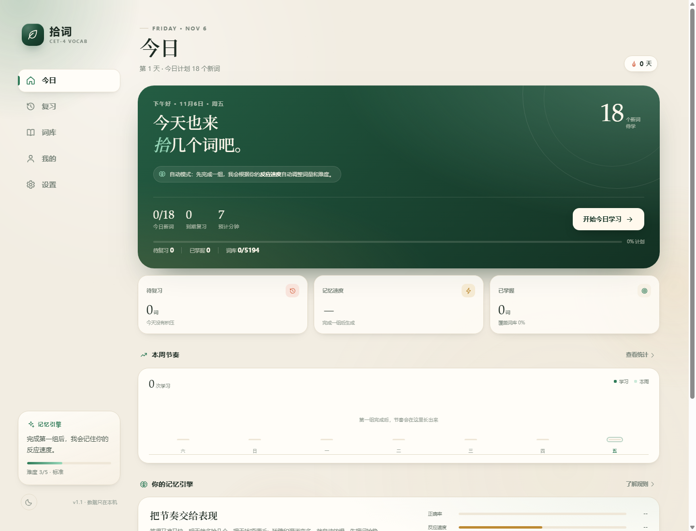
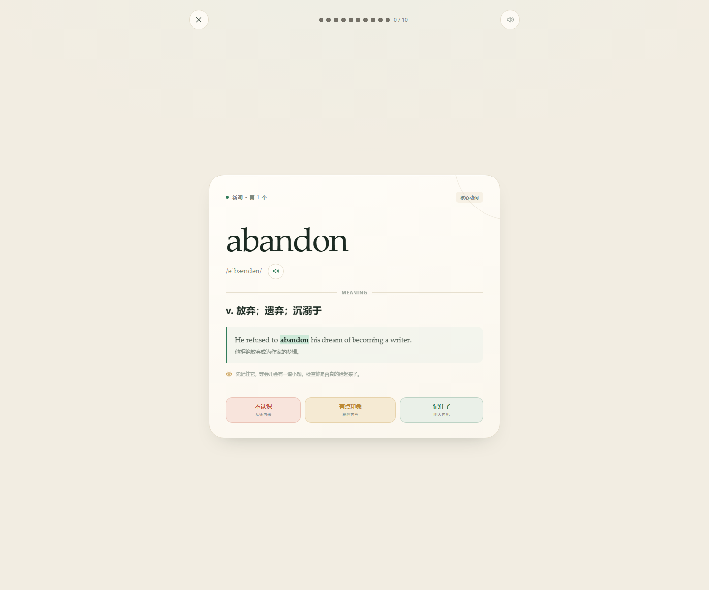
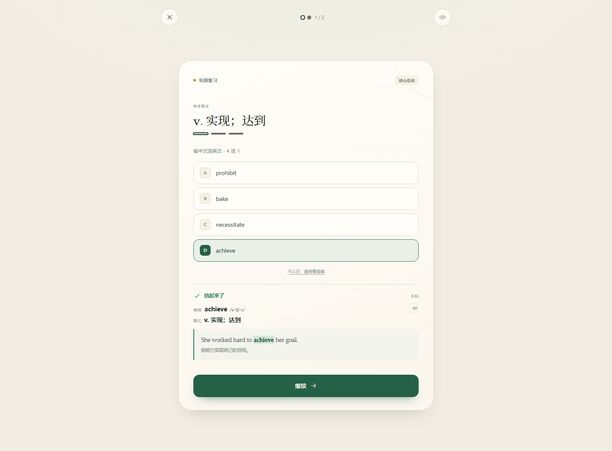
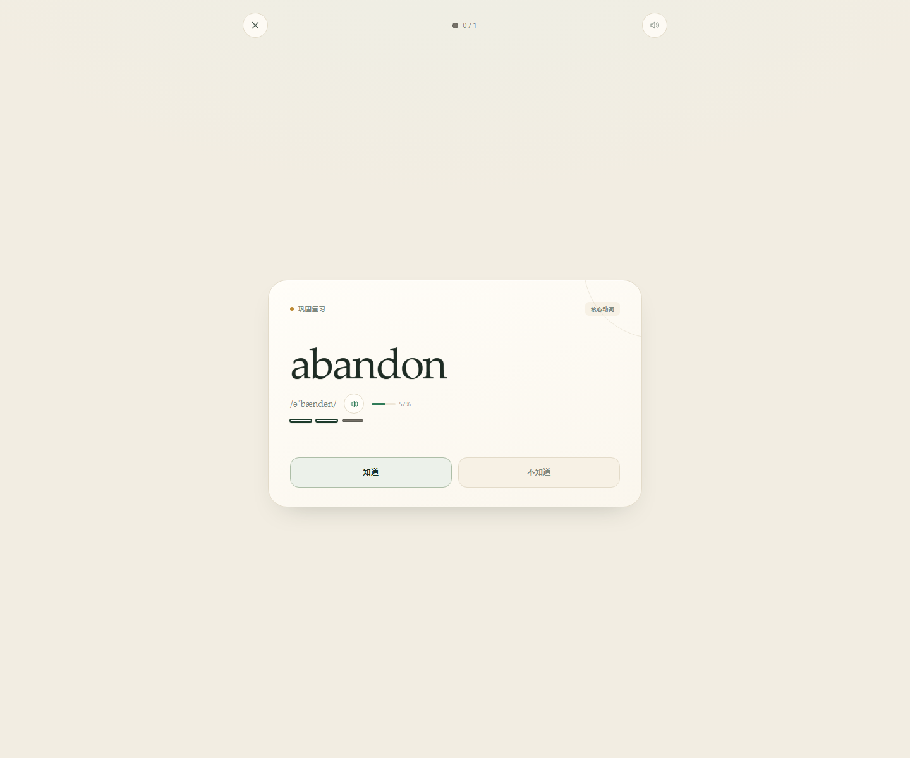
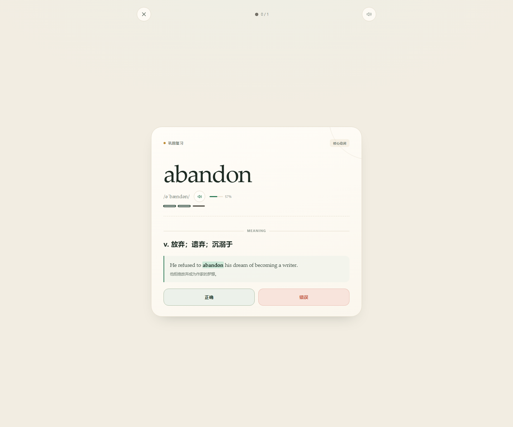
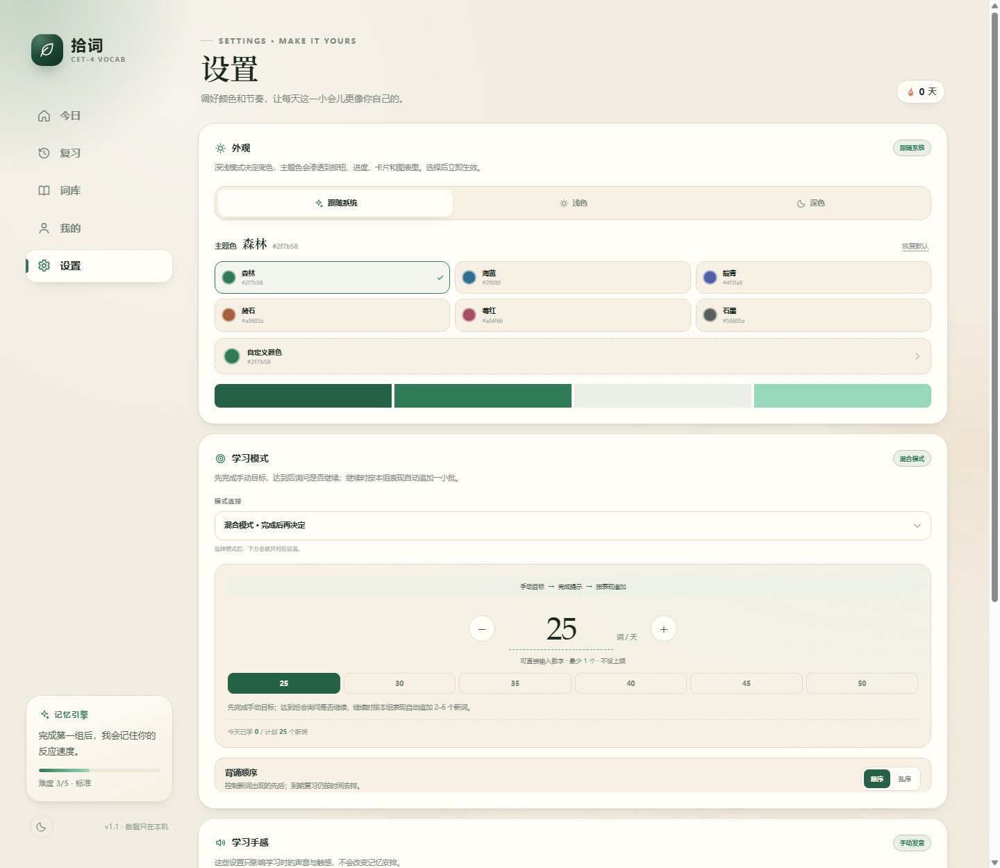
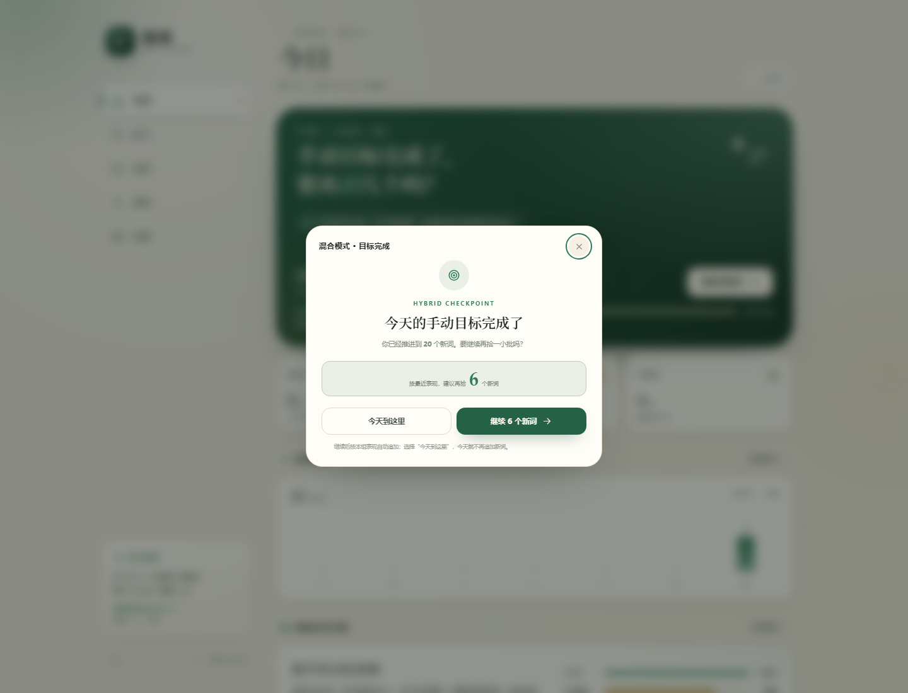
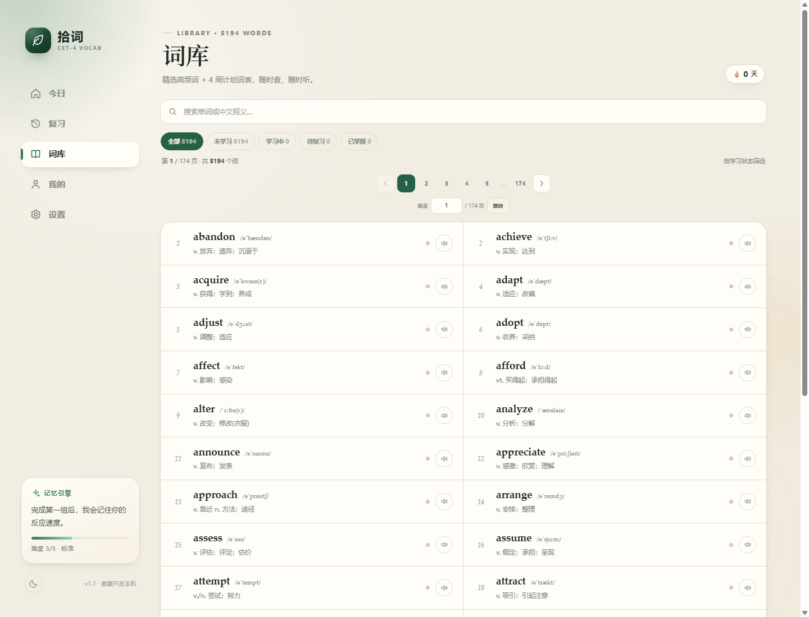

# 拾词 · CET-4 自适应刷词

一个不依赖后端的四级高频词刷词网页。单词卡、四/五选一测验、间隔复习、发音、学习统计和自适应词量都在一个页面里完成，数据只保存在本机浏览器。

## 预览

















## 直接打开

双击 `index.html` 即可。页面不需要安装依赖，也不会请求外部网络。

如果浏览器限制了本地文件的朗读或存储，可以在当前目录启动一个本地静态服务器：

```bash
python -m http.server 8080
```

然后访问 <http://localhost:8080>。

## 功能

- **5,194 个词条**：336 个精选高频词，加上 5 份「四级词汇 4 周背诵计划」PDF（Week 1–4 + Week +1）去重合并，包含同根扩展词。已有词条的释义以 PDF 为准。
- **新词学习卡**：先回想，再翻开释义、例句和翻译；用“不认识 / 有点印象 / 记住了”自评。精选词条带例句，PDF 补充词条以释义为主。
- **每组 10 个新词**：每组最多学习 10 个新词，最后一组按当天剩余数量收尾。
- **随机巩固**：新词的加固检查和连续三次复习会随机插入本组队列，不再固定隔几个词出现。
- **进度点**：顶部用 10 个点表示本组新词，灰色为未记住，白色为记住；上方只显示已记住数量 / 本组数量。
- **三次巩固**：自评“不认识”或任意一题答错后，该词进入连续答对 3 次的巩固流程；三次中错一次就清零，重新连续答对 3 次才算记住，并计入本组进度点。
- **短线计次**：需要巩固的词在词汇下方显示三条短线，答对一次变白一条；答错则三条全部变灰，不显示额外文字提示。
- **三种回忆**：普通新词检查按「看英文选释义 → 看中文选英文 → 只看单词自评」轮换；需要三次巩固的词也使用这三种方式。自评卡先选择「知道 / 不知道」，随后显示中文释义和例句，再选择「正确 / 错误」；选错误会重新进入三次循环，选正确才计入记住。
- **加固小测**：每个新词学完后会在本组稍后出现检查；需要巩固的词会持续回到队列，直到连续答对 3 次。
- **到期复习**：按间隔重复算法安排复习，答错的词会更快回来。
- **自适应难度**：根据正确率和反应时间，自动决定下一组是 3 选 1、4 选 1 还是 5 选 1，并优先使用同词性的干扰项。
- **三种学习模式**：设置页用「模式选择」下拉切换，选定后下方展开对应设置。
  - **手动模式**：固定每日词量，可直接输入任意正整数（至少 1 个，不设上限），快捷档为 25–50（每档 5）；达到目标后今天不再追加。
  - **自动模式**：由记忆引擎根据正确率和反应速度，每组在 6–36 之间自动调整次日词量。
  - **混合模式**：先完成手动目标；达到后弹出提示，询问是否继续。继续时按本组表现自动追加 2–6 个新词，每完成一轮可再次选择继续或结束。手动目标同样使用 25–50 快捷档。
- **背诵顺序**：在「学习模式」中选择顺序或乱序。乱序只改变新词的抽取顺序，到期复习仍按时间安排。
- **自适应桌面布局**：侧栏、内容宽度、间距和卡片尺寸会随浏览器窗口自动缩放；宽屏下词库自动变成双列。
- **词库分页**：词库每页 30 个词，使用页码、上一页/下一页和页码跳转浏览。
- **主题定制**：设置页提供 6 套主题色预设和自定义颜色选择器，颜色会同步到按钮、进度、图表和卡片。
- **学习统计**：连续天数、已掌握、正确率、平均反应、近 7 天节奏、未来 7 天复习压力。
- **发音**：使用浏览器内置的英文语音合成，可自动朗读，也可点小喇叭单独听。
- **数据备份**：支持导出/导入 JSON，清空记录前可以先留一份。
- **设置入口**：桌面侧边栏或手机底部「设置」，也可以从「我的」里的快捷卡片进入。
- **深浅色**：默认跟随系统，也可以手动切换。

## 自适应规则

每个词使用一个简化的 SM-2 间隔重复模型：

- 答对后，复习间隔从 1 天、3 天开始，按记忆难度和反应速度逐步拉长。
- 答错后，回到约 9 分钟后，并降低这个词的 ease（难度系数）。
- 新词自评“记住了”先安排 1 天；“有点印象”安排约 36 分钟；“不认识”安排约 6 分钟。
- 每组最多安排 10 个新词；每个新词在本组内完成一次检查，普通检查按「英→中 → 中→英 → 只看单词自评」三种方式轮换。
- 需要三次巩固时，三次依次为：汉选英、英选汉、只看单词自评；自评卡先选「知道 / 不知道」，显示释义后再选「正确 / 错误」，错误则清零重来。
- 加固检查和连续三次复习会随机插入队列，不固定隔几个词出现。
- 顶部的 10 个进度点按「已记住的新词数」点亮；普通新词在检查答对后点亮，出现“不认识”或答错的词要连续答对 3 次后才点亮。
- 自评“不认识”或检查答错时，该词进入连续正确计数：连续答对 3 次后清除标记并算记住；期间任何一次答错都会把计数清零，需要重新连续答对 3 次。

自动模式下，每组结束时：

- 正确率 ≥ 90% 且平均反应 ≤ 2.6 秒：次日新词 **+4**。
- 正确率 ≥ 82% 且平均反应 ≤ 4 秒：次日新词 **+2**。
- 正确率 < 60%：次日新词 **−5**。
- 正确率 < 72%：次日新词 **−3**。
- 平均反应 > 5.2 秒：次日新词 **−1**。
- 自动模式的词量范围是 **6–36**；手动模式和混合模式的手动目标不设上限，最少为 **1**。错词重练不会改变词量。
- 混合模式不会改动手动目标；达到目标后按本组表现追加 2–6 个新词，并再次询问是否继续。

难度由 0–1 的 `challenge` 控制：正确率高、反应快时上升，选项数量从 3 个增加到 4 个、5 个；状态下滑时回落。自动调整从下一天开始生效；手动目标与混合追加会立即更新今天的计划。

## 键盘操作

界面不再显示快捷键提示，但以下按键仍然有效。

| 场景 | 按键 |
| --- | --- |
| 新词卡 | `Space` / `Enter` 显示释义 |
| 新词自评 | `1` 不认识、`2` 有点印象、`3` 记住了 |
| 只看单词自评 | `1` 知道 / 正确、`2` 不知道 / 错误 |
| 选择题 | `A`–`E` 或 `1`–`5` 选择 |
| 答题后 | `Space` / `Enter` 继续 |
| 退出学习 | `Esc` |
| 词库页 | `/` 聚焦搜索框 |
| 词库页码输入框 | `Enter` 跳转页码 |
| 每日词量输入框 | `Enter` 保存目标 |

## 文件结构

```text
index.html              页面结构、图标和视区容器
assets/styles.css       视觉系统与响应式布局
assets/app.js           学习流程、自适应算法、统计和本地存储
assets/words.js         336 个精选词条数据
assets/words-pdf.js     从 5 份 PDF 词表整理的 5,183 条数据（运行时与精选词去重、覆盖释义）
README.md               本说明
```

## 数据说明

词库以 336 个精选高频词为底库，再合并用户提供的 5 份「四级词汇 4 周背诵计划」PDF，包含 Week 1–4 与 Week +1 的主词和同根扩展词。去重后共 5,194 个词条；PDF 中出现且与精选库同名的 325 个旧词条已采用 PDF 释义和音标，同时保留原有例句；PDF 未收录的 11 个精选词保留原释义。PDF 词条本身没有例句，学习卡会给出对应提示。

这些 PDF 是民间整理的四级词汇计划，不是官方发布的考试大纲；音标以英式音标为主，覆盖四级常见义项。精选词条例句为学习用例句，尽量保持简短自然。

所有进度保存在当前浏览器的 `localStorage` 中，键名为 `shici_cet4_state_v1`。清理浏览器站点数据会丢失进度，建议定期使用「设置 → 数据与备份 → 导出备份」。

